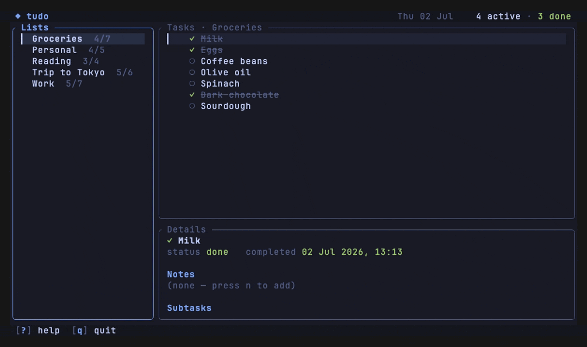

# tudo

A fast, local-first todo list **and markdown notebook** for your terminal. Fully keyboard-driven (with mouse support), no cloud, no accounts - your tasks are plain JSON files and your notes are plain `.md` files on your own disk.



## Features

- **Two tabs — Tasks and Notes**: press `1` for Tasks, `2` for Notes. The Tasks
  tab is the todo list below; the Notes tab is a markdown notebook (see
  [Notes](#notes)).
- **Multiple lists / projects**: switch between named lists in the sidebar.
- **Rich tasks**: priority, story points, due date, tags, free-text notes, and
  one level of checkable subtasks.
- **Tag filters across every list**: your tags live in their own pane pinned to
  the bottom of the sidebar (capped at half the height, scrolling on its own when
  there are many, so your lists always keep the top). Select a tag to see every
  task carrying it, pulled from all your lists into a single view (each row
  labelled with its home list). Edit, complete, or reschedule tasks right there —
  changes land back on their original list.
- **Reorder freely**: nudge a task up/down or send it straight to the top or
  bottom of its list — and reorder your lists in the sidebar the same way.
- **Sort on demand**: press `o` to order a list by priority, story points, due
  date, creation date, or title, in either direction (press `r` in the picker to
  flip) — or stay on manual order, where your own arrangement (and the reorder
  keys) rules.
- **Archive, don't delete**: press `d` to tuck a task into the dimmed
  **Archived** list (pinned at the bottom of the sidebar) instead of losing it;
  `X` deletes for good, and `m` moves a task back out to unarchive it.
- **Keyboard first, mouse friendly**: vim keys and arrow keys; click rows,
  click a checkbox to toggle, scroll to move.
- **Search & filter**: substring search across titles/tags/notes and a
  status filter (all / active / done).
- **Markdown notes**: organise notes into notebooks, write them in plain
  markdown, tag them inline (`#tag`) as you create them, pin, archive, and pop
  any note open in your `$EDITOR` (see [Notes](#notes)).
- **Human-readable storage**: one pretty-printed JSON file per list and one
  `.md` file per note, written atomically so a crash can't corrupt your data.
- **Local-first**: nothing leaves your machine.

<p align="center">
  <a href="https://buymeacoffee.com/jolley">
    
  </a>
</p>

## Install

### Quick install (prebuilt binary)

macOS and Linux:

```sh
curl -fsSL https://raw.githubusercontent.com/jolleydesign/tudo/main/install.sh | sh
```

This grabs the right binary for your platform from the latest [release](https://github.com/jolleydesign/tudo/releases) and installs it to
`~/.local/bin`. Set `TUDO_INSTALL_DIR` to install somewhere else, or `TUDO_VERSION` (e.g. `v0.1.0`) to pin a specific version.

**Updating:** re-run the install command above to upgrade to the latest release - it overwrites the existing binary in place. Check what you're running with `tudo --version`.

### With Homebrew

macOS and Linux (via [Homebrew](https://brew.sh)):

```sh
brew install jolleydesign/tudo/tudo
```

This taps `jolleydesign/homebrew-tudo` and installs the prebuilt binary. Upgrade later with `brew upgrade tudo`.

### With Cargo

From [crates.io](https://crates.io/crates/tudo-tui) - the crate is published as `tudo-tui` (the name `tudo` was taken), but the installed command is still `tudo`:

```sh
cargo install tudo-tui
```

Or build from source with a Rust toolchain (1.95+):

```sh
# straight from GitHub
cargo install --git https://github.com/jolleydesign/tudo

# or from a local checkout
cargo install --path .

# or just build and run
cargo run --release
```

`cargo install` puts a `tudo` binary on your `PATH` (usually `~/.cargo/bin`).

## First run

The first time you launch `tudo`, it asks where to keep your data and offers a
few standard locations (or a custom path). Your choice is remembered in a tiny
pointer file at `~/.config/tudo/config.json`. A starter list named **Tasks** is
created so you can begin immediately.

## Keybindings

Press `?` in the app for the same list grouped into an overlay — the overlay is
tab-aware, so on the Notes tab it shows the note bindings instead. All of these
keys are [customizable](#customizing-keybindings) in the config file, and the
help overlay always shows your current bindings. The tables below cover the
**Tasks** tab; the **Notes** tab reuses the same keys for the parallel notebook /
note operations (see [Notes](#notes)).

**Navigate**

| Key | Action |
|-----|--------|
| `1` / `2` | switch to the Tasks / Notes tab (works from either tab) |
| `Tab` / `Shift`+`Tab` | cycle focus through Lists → Tags → Tasks (and back) |
| `h`/`l`, `←`/`→` | jump between the sidebar and the Tasks pane |
| `j`/`k`, `↑`/`↓` | move the selection (flows from the lists into the tags) |
| `Enter` | open a task's detail view / drill into a list |
| `Esc` | close a dialog / leave detail / clear the filter |

**Organize**

| Key | Action |
|-----|--------|
| `Space` | toggle the selected task (or subtask) done |
| `J`/`K`, `Shift`+`↓`/`↑` | reorder the selected task (or list, when the sidebar is focused) down / up |
| `g`/`G` | send the selected task to the top / bottom of the list |
| `m` | move the selected task to another list (also how you unarchive) |

**Create & edit**

| Key | Action |
|-----|--------|
| `a` / `A` | add a task / add a list |
| `e` | edit the selected task's title, or rename the list when the Lists pane is focused |
| `s` | add a subtask |
| `p` | cycle priority (none → low → med → high) |
| `P` | set or clear story points (a whole number) |
| `D` | set or clear the due date |
| `t` | edit tags |
| `n` | edit notes (multi-line: `Enter` for a newline, `Ctrl+S` to save) |

**Remove**

| Key | Action |
|-----|--------|
| `d` | archive the selected task |
| `X` | permanently delete the selected task/list/subtask (asks to confirm) |

**Find & app**

| Key | Action |
|-----|--------|
| `/` | search (titles, tags, notes) |
| `f` | cycle the status filter (all / active / done) |
| `o` | sort tasks (menu: manual / priority / points / due date / created / A–Z; `r` flips direction) |
| `c` | copy the selected task (menu: full JSON / title / description) |
| `T` | open the theme picker |
| `S` | open settings (paths, data location) |
| `?` | show the help overlay |
| `q`, `Ctrl+C` | quit |

**Due-date input** accepts `YYYY-MM-DD`, `today`, `tomorrow`, or `+N` (N days
from today). An empty value clears the date.

**Quick-add syntax:** when adding a task (`a`) you can set its fields inline
instead of editing them one by one afterwards. For example:

```
Ship the release !! ~5 #work @tomorrow  n:double-check the changelog  s:tag it, publish, announce
```

creates a medium-priority task titled "Ship the release", estimated at 5 story
points, tagged `work`, due tomorrow, with that note and three subtasks. The
pieces:

| Marker | Sets | Notes |
|--------|------|-------|
| `!` `!!` `!!!` | priority low / medium / high | a standalone token (4+ marks = high) |
| `~N` | story points | `~` + a whole number (last one wins) |
| `#tag` | a tag | repeatable |
| `@date` | due date | `@` + anything the due-date input accepts (`@today`, `@+3`, `@2026-07-10`) |
| `n:…` | notes | runs to the next `n:`/`s:`; repeats join with newlines |
| `s:a, b, c` | subtasks | comma-separated; repeats accumulate |

Priority, points, tags, and the date can appear in any order and anywhere before
the first `n:`/`s:`; everything after that is note/subtask text. Markers are only
recognised at a word boundary, so a plain "We won!" or "C# rewrite" keeps its
punctuation, and anything unrecognised just stays in the title.

**Mouse:** click a list or task to select it, click a task's checkbox to toggle it done, and use the scroll wheel to move within the focused pane.

## Notes

Press `2` (or click the **Notes** tab in the header) to switch from tasks to your
markdown notebook. Press `1` to switch back. The layout mirrors the Tasks tab:
**notebooks** in the sidebar (with a note-tags pane pinned below them, just like
task tags), a **note list** top-right, and a live **preview** of the selected
note below it. Press `Enter` on a note to open it in the **full-screen editor**
(`Esc` or `Ctrl+S` saves and closes — it autosaves either way); for longer
writing, `E` hands the file to your `$EDITOR`.

Notes are plain markdown, and the editor and preview **dim the markup** —
heading `#`s, list bullets, blockquote `>`s, code fences, and inline
`` ` ``/`**` delimiters recede into a muted colour so the text you wrote stands
out. Tags and pinning are stored in a small YAML frontmatter block at the top of
each file, so the files stay portable and can be edited by any other tool.

**Notes-tab keys** (the same keys as the Tasks tab, doing the notebook/note
equivalent):

| Key | Action |
|-----|--------|
| `a` / `A` | add a note / add a notebook — type `#tag` tokens in the note title to tag it (like the task quick-add) |
| `e` | edit the note's title, or rename the notebook when the Notebooks pane is focused |
| `Enter` / `n` | open the full-screen body editor — arrow keys & `PageUp`/`Down` (and the scroll wheel) navigate and it scrolls for long notes; `Enter` inserts a newline; `Esc` or `Ctrl+S` saves & closes |
| `E` | open the selected note in your `$EDITOR` (`$VISUAL`/`$EDITOR`, falling back to `vi`) |
| `t` | edit the note's tags |
| `*` | pin / unpin the note (pinned notes float to the top) |
| `J`/`K` | reorder the selected note — or the notebook, when the Notebooks pane is focused (manual sort only) |
| `g`/`G` | send the selected note to the top / bottom (manual sort only) |
| `c` | copy the note (menu: body / title / full markdown) |
| `/` | search notes (title, body, tags) |
| `o` | sort notes (manual / A–Z / created / modified; `r` flips direction) |
| `d` | archive the selected note |
| `m` | move the note to another notebook (also how you unarchive) |
| `X` | delete the selected note or notebook (asks to confirm) |
| `#` | jump to the note-tags pane; select a tag to see every note carrying it across all notebooks |

The built-in editor is full-screen; for longer writing, `E` hands the file to
your `$EDITOR` and reloads it when you're done.

Just like tasks, notes have an **Archived** notebook pinned to the bottom of the
sidebar (dimmed): `d` tucks a note away there, `m` moves it back out to
unarchive (or to any other notebook), and `X` deletes for good. Archived notes
drop out of the tag view, and the Archived notebook itself can't be renamed or
deleted.

## Themes

Press `T` to open the **theme picker**: browse with `↑/↓` to preview each theme live across the whole UI, `Enter` to apply, `Esc` to revert. Twelve palettes are built in - **Tokyo Night**, **Catppuccin Mocha**, **Dracula**,
**Nord**, **Gruvbox Dark**, **Gruvbox Material**, **Solarized Dark**, **One Dark**, **Rosé Pine**,
**Gotham**, **Black & White**, and **Terminal** (default). Your choice is
remembered in the config pointer.

The coloured themes are truecolor, so they look the same regardless of your terminal's own theme; **Terminal** does the opposite - it forces no background and uses the 16 ANSI colours, so the app adopts your terminal's scheme. Set `TUDO_THEME` (e.g. `TUDO_THEME=dracula` or `TUDO_THEME=none`) to override the theme for a single run.

## Settings & configuration

Press `S` to open the settings panel, which shows your **data directory**, the **config file** path, the storage format, the active theme, your list/task counts, and any environment overrides currently in effect.

Configuration is a small **JSON** file (not TOML) - `~/.config/tudo/config.json` by default (override with `$TUDO_CONFIG`). It holds the `data_dir`, the `theme`, and optional `keybindings`; everything else (your actual lists) lives as separate JSON files in the data directory. To move your data, press `S` then `d`, type a new path (`~` is allowed), and `Enter` - tudo moves your list files there and repoints the config.

## Customizing keybindings

tudo writes a full `keybindings` block into your `config.json` (on first run, and it fills in any missing actions on upgrade), so you don't have to author it from scratch - just edit the keys you want and restart tudo. Each entry maps an **action name** to the list of keys that trigger it; the list **replaces** that action's defaults, so include every key you want for it. For example, to add `Ctrl` alternatives to a few actions:

```json
{
  "data_dir": "/Users/you/.local/share/tudo",
  "theme": "dracula",
  "keybindings": {
    "move-down": ["j", "down", "ctrl+n"],
    "move-up": ["k", "up", "ctrl+p"],
    "quit": ["q", "ctrl+q"],
    "search": ["/", "ctrl+f"]
  }
}
```

**Key syntax:** a single character is that key, case-sensitive (`j` vs `J`). Named keys are `space`, `tab`, `enter`, `esc`, `up`, `down`, `left`, `right`, `home`, `end`, `pageup`, `pagedown`, `backspace`, `delete`, and `insert`. Add modifiers with `ctrl+`, `alt+`, or `shift+` (e.g. `ctrl+q`, `shift+down`); for letters just use the uppercase letter (`J`) rather than `shift+j`.

**Action names** (defaults in parentheses):

| Action | Default | Does |
|--------|---------|------|
| `toggle-focus` | `tab` / `backtab` | toggle focus between the sidebar and the Tasks pane |
| `focus-lists` / `focus-tasks` / `focus-tags` | `h`/`left`, `l`/`right`, `#` | jump to the lists / the Tasks pane / the tags |
| `move-down` / `move-up` | `j`/`down`, `k`/`up` | move the selection |
| `activate` | `enter` | open a task's detail / drill into a list |
| `back` | `esc` | close a dialog / leave detail / clear the filter |
| `toggle-done` | `space` | toggle the selected task or subtask done |
| `reorder-down` / `reorder-up` | `J`/`shift+down`, `K`/`shift+up` | reorder the task (or list, when the sidebar is focused) down / up |
| `send-top` / `send-bottom` | `g` / `G` | send the task to the top / bottom |
| `move-task` | `m` | move the task to another list (also unarchives) |
| `add-task` / `add-list` | `a` / `A` | add a task / a list |
| `edit` | `e` | edit the task title, or rename the list |
| `add-subtask` | `s` | add a subtask |
| `cycle-priority` | `p` | cycle priority (none → low → med → high) |
| `set-points` | `P` | set or clear story points (a whole number) |
| `set-due` | `D` | set or clear the due date |
| `set-tags` | `t` | edit tags |
| `set-notes` | `n` | edit notes |
| `archive` | `d` | archive the selected task |
| `delete` | `X` | permanently delete (asks to confirm) |
| `search` | `/` | search titles, tags, and notes |
| `cycle-filter` | `f` | cycle the status filter (all / active / done) |
| `sort` | `o` | open the sort picker (manual / priority / points / due date / created / A–Z; `r` flips direction) |
| `copy` | `c` | copy the selected task |
| `theme-picker` | `T` | open the theme picker |
| `settings` | `S` | open settings |
| `help` | `?` | show the help overlay |
| `quit` | `q` | quit |

Notes: `Ctrl+C` always quits and can't be disabled. Only these main (Normal/Detail) keys are configurable - text entry, confirm prompts, and the pickers keep fixed keys. Entries with an unknown action name or an unrecognized key are ignored (with a brief notice when the app starts) but left untouched in your config, so a typo won't wipe the rest of your settings.

## Storage format

Each list is a single JSON file (`<slug>.json`) in your data directory:

```json
{
  "name": "Work",
  "tasks": [
    {
      "id": "f7c1…",
      "title": "Ship the TUI",
      "done": false,
      "priority": "high",
      "points": 8,
      "due": "2026-07-01",
      "tags": ["rust", "urgent"],
      "notes": "the big one",
      "subtasks": [
        { "id": "a2…", "title": "data model", "done": true }
      ],
      "created": "2026-06-28T14:40:00Z",
      "completed_at": null
    }
  ]
}
```

Notes live in a `notes/` subdirectory: one folder per notebook (the folder name
is the notebook's name), one `.md` file per note. Each note carries its metadata
in a YAML frontmatter block:

```
notes/
  Work Ideas/
    api-redesign.md
    standup-notes.md
  Personal/
    reading-list.md
```

```markdown
---
title: API redesign
tags: [work, backend]
pinned: true
order: 1
created: 2026-07-05T10:00:00Z
---
The body is plain markdown, starting here.
```

Edit any of these by hand or keep them in a git repo - they're just text.

## Environment variables

- `TUDO_DIR` - override the data directory (skips the saved config; great for
  scoping tasks to a project or for scripting).
- `TUDO_CONFIG` - override the location of the config pointer file.
- `TUDO_THEME` - override the theme for one run (`tokyo-night`, `catppuccin`,
  `dracula`, `nord`, `gruvbox`, `gruvbox-material`, `solarized`, `one-dark`,
  `rose-pine`, `gotham`, `black-white`, or `none`/`terminal`).

## Development

```sh
cargo test       # unit + headless render tests (no real terminal needed)
cargo clippy --all-targets
cargo run
```

Source layout: `model` (types), `storage` (JSON I/O), `config` (data-dir resolution), `keybind` (configurable keymap), `app` (state + actions), `event` (key/mouse mapping), `ui` (rendering). The action logic and rendering are terminal-free, so they're tested directly with `tempfile` and ratatui's `TestBackend`.
